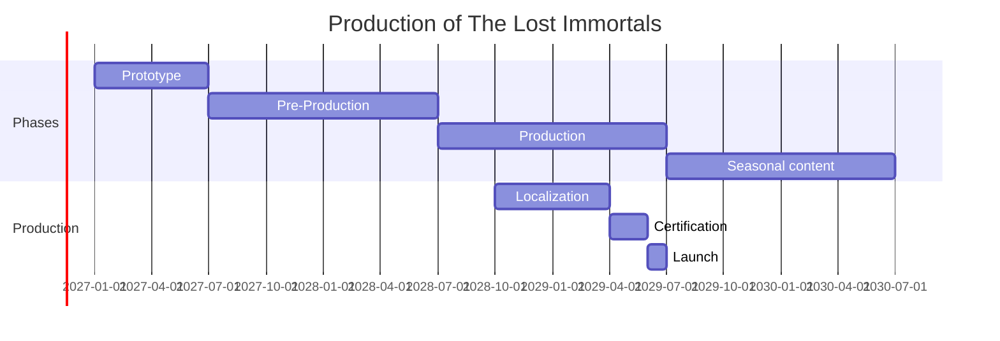

# Production Plan for Game Pitch C

Due to how well this plan adhere's to the pitch you love, it is guaranteed to get you the most money while actually shipping the game in the proposed timeframe!

# Matching pitch with producers insights

Pitch C emphasizes robbery, killing, and a dark swamp enviroment. Those elements would have to be removed to ensure an ESRB rating of "E". Instead, we'll target E10+ to enable more closely matching the pitch that you love!

# Team Structure
Rather than re-hiring staff for the changing demands of each phase. We will modify asks for each staff during each phase.

|Role | Prototype | Pre-Production | Production |
|---|---|---|---|
| Creative Director | vision ownership, feature and milestone prioritization, game narrative | world planning, publishing strategy, external playtesting | scope control, content reviews, live operations planning |
| Lead Programmer | systems for; deconstruction, inventory, & crafting | systems for; saving the game, role playing/story, & proc gen infinite world | optimization & build management |
| Programmer | Character controller, combat, resource gathering | systems for: NPC, quests, & economy | Bug fixing |
| Tech Artist: Enviroment | Terrain & Biomes | World art pipeline, Audio | World building, lighting, & optimization |
| Artist: Character | player character, placeholder art | NPC pipeline, creatures, & mounts | Bosses & polish
| Designer | Narrative for quests & UX design | Lore, NPC dialogue, & Tutorials | QA management; bug verification, localization review, etc.. |

# Tech Stack

1. Game Engine: Unreal. Unreal is a fit because:
    1. We are an Unreal shop. We already work with contacts that work in Unreal.
    2. We're making a PC only game. PC is the main platform Unreal is known to work well on.
    3. We want realistic graphics.
2. Source Control: git - we'll give the lead programmer a day to setup a git server locally, such as GHE (GitHub Enterprise).
3. Project Managent: Discord, it's the new slack.
4. Documentation: Markdown inside the git repository, reusing source control tech reduces tool swapping.
5. Localization: Crowdin, popular tool that also supports outsourcing if project falls behind schedule.
6. Audio: FMOD & Audacity, both are popular industry staples
7. Art: Blender & Substance Painter, both are popular industry staples

# Development

## Prototype - 6 months long. Months 1-6

Goal: Prove that ultimate control over the playspace is fun.

Deliverables:
1. Deconstruction system: Mine terrain, remove objects, collect materials.
2. Craft: 20 recipes, player placeable workbench
3. Exploration: 2 biomes, resource loops.
4. Combat: Melee sword, Ranged bow & arrow.
5. NPC: basic quests.

Player can: gather, build, fight, explore, complete quests.

## Pre-Production - 12 months long. Months 7-18

Goal: Build vertical slice.

Deliverables:
1. RPG framework: Stats, skills, equipment.
2. NPC framework: Main story, quests, favorability, branching dialogue.
3. World framework: village, 2 dungeons, 3 biomes.
4. Character framework: flying, eat & drink to survive.
4. Localization framework: Crowdin integration.
5. Save system.

Player has: 2 hours gameplay, 1 village, 2 dungeons, & 3 biomes to explore.

## Production - 12 months long. Months 19-30

Goal: Finalize content and prepare launch

Deliverables:
1. World: 5 biomes total; forest, swamp, desert, mountain, & ocean. 1 capital city, 4 villages, 8 dungeons.
3. NPCs: 50 NPC, Relationship stories.
4. Enemies: 30 types
5. Crafting: 300 recipes

### Localization - Months 22 - 28

Translations: French, Italian, German, Spanish, 
Chinese, & Japanese.
Localization passes:
1. Machine-assisted translation.
2. Native editor review.
3. Contextual in-game review.
4. LQA testing.

### Certification - Months 27 - 29

ESRB & PEGI submissions to approvals.

### Dark Launch - Month 30

Invite 500 - 2000 players with the objective of: Performance and stability validation, balance review, localization feedback.

## Seasonal content

Post-launch content promises to players: 4 seasons yearly.
1. Spring: Floral building set, Mount cosmetics, seasonal forest biome quests.
2. Summer: seasonal ocean biome quests, ship costmetics.
3. Autumn: season dungeon quests, armor cosmetics.
4. Winter: seasonal mountain biome quests, ice building sets, holiday cosmetics.

# Box Product

The box product will include; a game code, art booklet, NPC figure shaped USB flashdrive loaded with the soundtrack.

# Gantt Chart

# Risks

Probability of issues accuring and plan of mitigation.

High risk:
1. World destruction tech too expensive? Limit edible assets
2. Open-world scope creep? Limit launch biome count
3. Performance issues? Being optimization by Month 18

Medium risk:
1. Localization delays? Freeze dialog by Month 22
2. Narrative burnout? Quest templates
3. Team burnout? Quarterly scope adjustments

# Remaining Issues

1. No fallback plan if the prototype or pre-production phase reveal the game should be abandoned.
2. This plan may make the producer so much money that he leaves the company to retire.
